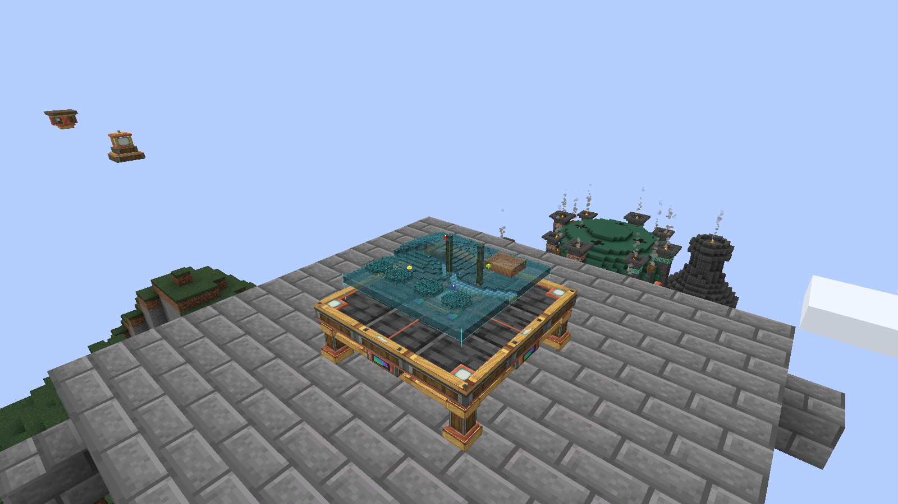

# Create: Hololith

A mechanical surveying table that projects a real miniature Minecraft landscape.
Explore hills, forests, rivers and buildings in three dimensions, link a sensor or
remote beacon, and mark reference points with sixteen dye colors.

**Minecraft Java 1.21.1 · NeoForge 21.1.259 · Create 6.0.10 · Java 21**

This tested development preview contains the complete buildable source. The
existing [0.3.0 release and downloads](https://github.com/shaggybigt/create-hololith/releases/tag/v0.3.0)
remain available. No new public release is created by the build workflow.



[Interior lighting](images/interior.png) · [Aboard a Sable ship](images/ship.png) ·
[Create bearing](images/contraption-bearing.png) · [Moving minecart](images/contraption-cart.png)

[Instrument panel](images/control-panel.png) · [Marker Ponder tutorial](images/ponder-markers.png) ·
[Survey-source tutorial](images/ponder-sources.png)

[Demonstration world and recording guide](docs/showcase.md)

## What it does

- Projects textured terrain with genuine elevation, water surfaces, roofs and
  raised tree canopies over a brass-and-andesite 3×3 table.
- Surveys 32×32, 64×64 or 128×128 blocks, with map rotation, magnification and relief.
- Follows local sensors, visits remote beacons or selects world coordinates using
  physical Survey Cards and the table's instrument panel.
- Shows individually colored reference pins at their world X/Z positions, including
  enclosed or buried markers. Pins sit over the surveyed surface regardless of the
  reference blocks' elevation.
- Works on ordinary Create contraptions and optionally Aeronautics/Sable ships.
- Keeps previously surveyed terrain available without force-loading distant chunks.
- Offers an in-game brightness slider and contextual instrument/card tooltips in
  this development build.
- Includes three Create-style Ponder tutorials for the table, survey sources and
  colored reference markers; hover an item and hold the configured Ponder key.
- Reports live, cached, incomplete and unavailable terrain, with clear card/link
  confirmations and status that becomes live only after a recent completed scan.

Read the [player guide](docs/usage.md), [contraption guide](docs/contraptions.md)
and [tested behavior and limits](docs/development-validation.md). This is a surface survey:
interiors and caves are not reconstructed, and unknown terrain stays blank.

## Install

1. Use **Java 21**, **Minecraft 1.21.1**, **NeoForge 21.1.259** and the official
   **Create 6.0.10** NeoForge JAR with its bundled dependencies.
2. Download the player JAR from an [existing release](https://github.com/shaggybigt/create-hololith/releases),
   or build this development branch below.
3. Close the game and server. Put one `create-hololith-<version>.jar` in **both client
   and server** `mods` directories, replacing the older Hololith JAR. Single-player
   needs it in the client's `mods` directory. All players and the server need the
   same Hololith version.
4. For ships, also install **Create: Aeronautics 1.3.2** and **Sable 2.0.6**.
   These are optional; ordinary Create contraptions need no additional mod.

Do not install a `-sources.jar`, project ZIP or `hololith-probe` JAR for normal play.
The reference map mods and CC:Tweaked are not required. Instruments have survival
recipes and a **Create: Hololith** creative tab.

## Build from source

Install a **64-bit JDK 21**, clone the development branch, then run its Gradle wrapper:

```sh
git clone --branch development/qol-showcase https://github.com/shaggybigt/create-hololith.git
cd create-hololith
./gradlew build
```

The complete source is on `development/qol-showcase` while this draft is under
review; `main` still preserves the previous release repository.

On Windows use `gradlew.bat build`. If the Unix wrapper is not executable, use
`bash ./gradlew build`. The wrapper downloads the pinned dependencies, including
the exact official Create distribution, and verifies its SHA-256. No installed
Minecraft instance, private file paths or manually downloaded library JARs are
required. The first build needs internet access and may take several minutes.

Player and source JARs appear in **`build/libs/`**; automated test results appear
in `build/reports/tests/test/`. `./gradlew runClient` starts a separate development
client. See [build and validation setup](docs/building.md) for dependency versions,
optional local modpack integration and the isolated gameplay probe.

## Project layout

| Path | Contents |
|---|---|
| `src/main/` | Addon source, translations, models, recipes and Ponder resources |
| `src/test/` | Automated unit tests |
| `src/probe/` | Disposable-world gameplay validation and demonstration harness |
| `docs/` | Player instructions, architecture, provenance and validation evidence |
| `images/` | Actual Minecraft screenshots |
| `scripts/` | Optional local validation and packaging helpers |
| `.github/workflows/` | Compile/test workflow with read-only repository permissions |

Generated builds, worlds, raw recordings, logs and machine-specific paths belong
outside Git. CI compiles and runs automated checks; it cannot establish visual
quality, multiplayer behavior or every contraption controller's gameplay behavior.

## License and credits

Hololith is available under the existing [MIT license](LICENSE). It was developed
primarily with AI coding tools under human direction. See
[reference investigation and provenance](docs/references.md) for the independent
implementations and third-party APIs/assets, and [dependency details](docs/building.md#dependencies)
for the external libraries used during development. Minecraft and Create textures
are referenced from the installed resource atlas; raw texture assets are not bundled
in the addon. Screenshots show their actual in-game rendering.
