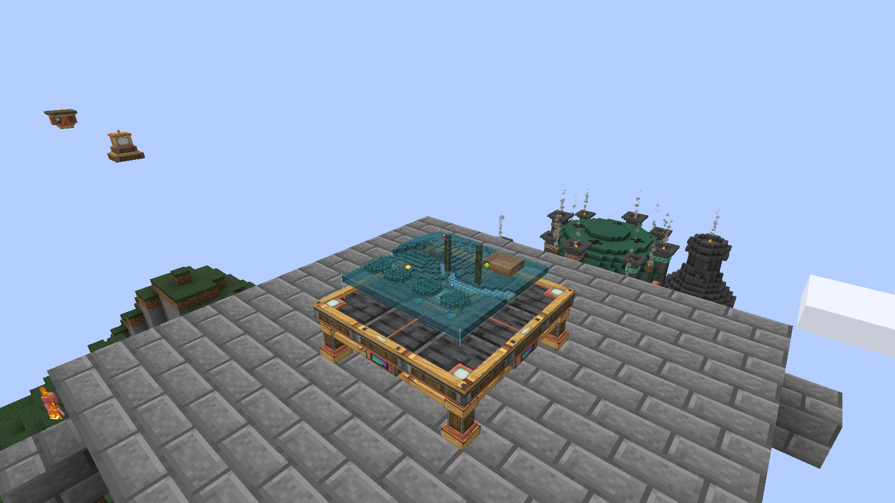

# Create: Hololith 0.2.1

**[Download Hololith 0.2.1](https://github.com/shaggybigt/create-hololith/releases/tag/v0.2.1)** · **[Installable mod JAR](https://github.com/shaggybigt/create-hololith/releases/download/v0.2.1/create-hololith-0.2.1.jar)** · **[Complete buildable source project](https://github.com/shaggybigt/create-hololith/releases/download/v0.2.1/create-hololith-0.2.1-project.zip)**

This repository hosts the release documentation and screenshots. The complete
source code, Gradle wrapper, assets, tests and validation evidence are in the
`create-hololith-0.2.1-project.zip` release asset. Use that archive to develop or
rebuild the addon; GitHub's automatically generated “Source code” archives
contain this documentation repository.

A terrain-surveying addon for Minecraft Java **1.21.1**, NeoForge **21.1.259**,
Create **6.0.10** and **Java 21**. A mechanical table projects a miniature 3D
landscape, with local sensors, remote beacons, saved surveys and colored
reference markers. Aeronautics **1.3.2** / Sable **2.0.6** provide optional
moving-airship integration; stationary surveying does not require them.

Open-source under the [MIT license](LICENSE).

Developed primarily with AI coding tools under human direction. See
[validation and remaining limits](validation.md) for tested versions,
environments and results.



[Interior lighting](interior.png) · [Projection aboard a Sable ship](ship.png)

## Install

1. Close Minecraft and the server.
2. Install Minecraft Java **1.21.1**, NeoForge **21.1.259**, and the official
   Create **6.0.10** NeoForge JAR (with its bundled dependencies), using **Java 21**.
3. Put `create-hololith-0.2.1.jar` in the **client and server** `mods` folders.
   Remove any previous Hololith JAR so only one version is installed. For
   single-player, install it in the client's `mods` folder.
4. Aeronautics **1.3.2** and Sable **2.0.6** are optional for ship use. The
   three reference map mods are not dependencies.
5. Launch normally. The five items have survival recipes and a **Create: Hololith**
   creative tab. Do not install `hololith-probe` or a `-sources.jar` for play.

Development tests run in a separate disposable game directory. See
[validation](validation.md) for the checks performed and remaining limits.

## Use the instrument

- Place the **Hololith Surveying Table** in a clear, dry 3×3 space. Aim at the
  intended center tile. It scans its own surroundings by default.
- Right-click a table tile with an empty hand to open its instrument panel.
  Choose a **32×32**, **64×64** or **128×128** block area, quarter-turn rotation,
  projection size and normal/double relief. Press **Apply survey settings**.
  Projection size enlarges the hologram; Area changes the world coverage.
- A Create wrench rotates the map. Sneak-wrench cycles the survey area.
- Put a **Local Survey Sensor** under your vessel or elsewhere in the world.
  Use a **Survey Card** on the sensor, then use that card on the table. The table
  follows the sensor's world position; the link survives ordinary save/reload and
  is based on a UUID rather than the block's current coordinates.
  Breaking and replacing a sensor gives it a new identity: record and link it again.
- A **Remote Survey Beacon** uses the same linking method. Place it at a base,
  record it on a card, and link the table elsewhere. These links can cross
  dimensions when the target dimension is present on the server.
- Sneak-use a card on ordinary terrain to record its coordinates, then apply it
  to the table. Alternatively choose **Source: coordinates** in the panel and
  enter the dimension ID, X and Z. Coordinates are world positions, not ship
  storage positions.
- Reuse a card on another sensor/terrain to overwrite its target. Reapplying
  a card changes the table's target. **Source: table** restores local scanning.

Leave the table a moment to acquire its first survey. A projection can be partial
if only some target chunks are loaded. Unknown columns remain blank. Previously
surveyed columns remain visible when their chunks unload; the panel reports the
live/cached state. A beacon is **not a chunk loader**. Visit distant terrain or
keep it naturally loaded to obtain new data. Links are instruments, not access
controls; players who can reach a table can operate it.

Sensors and beacons report locations; an active linked table performs the scan.
Capture a region while it is loaded before leaving it. Cached surveys belong to
a particular center and area setting, and old shared surveys can be evicted.
Changing targets or area requires loaded terrain unless that survey is cached.
The cache is shared across the server: coordinate mode can survey any naturally
loaded region, without per-player exploration or ownership restrictions.
The instruments require no rotational power, fuel or CC:Tweaked computer.

## Reference markers

Craft **Reference Markers** in batches of four. They are small brass-and-copper
lamps with a colored lens. The blocks can be exposed, enclosed or buried; they
do not need a view of the sky, terrain, table or player.

1. For markers following a sensor survey, record the sensor or beacon on a
   Survey Card as usual, then use that card on each reference block. Link the
   table to the same sensor. Every table viewing that sensor can show its markers.
2. For a direct table link, **sneak-use a Survey Card on any table tile**, then
   use that card on each reference block. Direct links stay with that table when
   its survey source changes. A table card does not retarget another table.
3. Use any of Minecraft's **16 dyes** on a placed reference to set its individual
   color. Survival recoloring consumes one dye only when the color changes.
   Mining preserves the dye color; replacing a block creates a new reference
   identity and needs a new link.
4. **Sneak-use a Create wrench** on a reference to unlink it. Empty-hand use
   reports its link status and color.

For the cargo-lift use case, mount four references at the opening's corners,
color them individually, and apply the same sensor card to all four. Assemble
them with the sensor and table on the ship. Their world X/Z positions, including
ship rotation, become small colored pins over the surveyed ground. Their actual
elevation does not set pin height. Reference blocks themselves are excluded from
the top of a terrain sample so a free-standing overhead reference cannot lift
its own pin; normal roofs and terrain remain part of the surface survey.

Markers follow the **currently displayed completed survey**. Out-of-area,
other-dimension and unknown-terrain locations are hidden. Movement is sampled
four times per second, with 1/256-block position quantization. Markers use the
same map rotation, magnification, relief and cached mesh height scale as terrain.
At most **64** in-area markers appear per table, ordered stably by identity.
They require no additional terrain scans. Changed positions travel separately
from the terrain snapshot; stationary markers send no recurring position packet.

Reference blocks must be in ticking, loaded chunks or an active Sable sublevel.
An unloaded/removed reference disappears promptly (within roughly one second)
instead of leaving an outdated pin. Its saved link and color return when it loads.
No marker chunk is force-loaded. A missing table or replaced sensor can be
resolved by recording the new target and reapplying the card. Links and table
identities survive save/reload and Sable relocation; old 0.1.0 tables gain an
identity automatically when loaded.

## Hologram lighting

The projection combines surface textures, biome colors and geometry with
emissive shading and thin additive highlights on exposed
terrain edges. It uses Minecraft's existing shaders; no shader pack or
postprocessing bloom is required. Colored pins have white cores and subtle
ground halos to remain distinguishable on both bright and dark terrain.

Edit `config/hololith-client.toml` on each client to adjust
`hologramIntensity` from **0.4 to 1.8** (default **1.0**), then restart the client.
This changes local terrain, edge and marker brightness without new surveys or
GPU terrain rebuilds. The original mesh rebuild/cache limits remain in place;
the added cached glow buffer is capped at 4,096 small edge quads per survey.

## Survey fidelity and cost

The projection is actual 3D geometry: sampled ground and roofs, exposed cliff
faces, raised leaf canopies and a separate water surface. It uses world block
materials and biome colors. It is a surface survey, not a complete voxel copy:
interiors, cave systems, overhang undersides and individual branches are not
reconstructed. Trees and deep water are probed at most 32 blocks below the top.
The Nether survey shows the heightmap surface, including the roof.
Tall terrain is uniformly compressed vertically to fit the projection, preserving
relative heights. Relief doubles that fitted height; it is not an absolute altitude scale.

32/64-block areas sample every column. The 128-block area samples every other
column (64×64 samples); narrow details can disappear at this scale. Moving targets
are aligned to four-block increments to avoid rebuilding on every small movement.
Scans are spread across ticks and check loaded chunks only. Changes normally appear
after a five-second refresh plus queue/scan time. There is no continuous full scan.

Server settings are in the world's `serverconfig/hololith-server.toml`:
`columnsPerTick` (512), `refreshTicks` (100), `cachedRegions` (64). All tables share
the scan budget; the scanner also yields after approximately 2 ms per tick
(checked between small batches). A maximum of 128 pending regions and 512 recent
request keys bounds queue memory. Saved regions use block-state palettes, not
unstable runtime registry IDs. The world file `data/hololith_surveys.dat` holds
the bounded shared cache and sensor directory; tables also save their own last
snapshot in their block entity NBT.

## Build from source

Download and extract the complete project ZIP linked above, then open its
create-hololith directory before running the commands below.

Install Java 21, obtain the official Create 6.0.10 JAR, then choose a writable
development directory and pass both paths to Gradle. For example, on Windows:

```powershell
.\gradlew.bat -PruntimeRoot=C:/HololithDev -PcreateJar=C:/mods/create-1.21.1-6.0.10.jar build
```

On Linux or macOS, run `chmod +x gradlew` if needed, then use `./gradlew` with equivalent absolute paths. Build outputs
are written to `<runtimeRoot>/development/hololith/build/libs`. The scripts in
`scripts/` are local validation helpers with environment-specific paths and
disposable-world safeguards; use the Gradle wrapper for a portable build.

The first build downloads NeoForge dependencies. Tests need the official Create
6.0.10 JAR because NeoForge validates actual mod dependencies during its test boot.
This test dependency is not bundled in Hololith. `-sources.jar` contains the Java
and resources; the complete project archive also contains Gradle scripts,
documentation and the isolated test harness.

Version 0.2.1 replaces the earlier GPU-buffer helper with the independently
authored `ProjectionBuffer`, implemented from Minecraft/NeoForge API sources.
No source code from the reference map projects is retained.
See [reference investigation and provenance](references.md) and
[Aeronautics integration](aeronautics.md).
