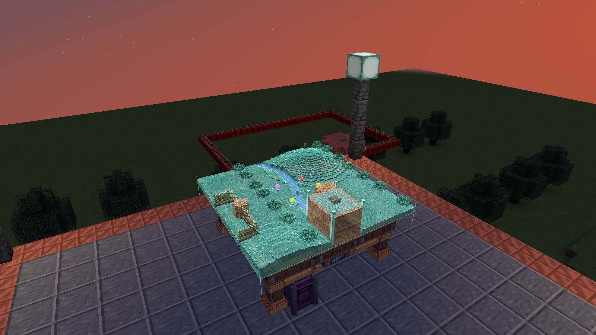

# Create: Hololith

A Create-powered surveying table that projects a miniature, textured Minecraft
landscape. Explore terrain, follow a survey sensor and mark reference points with
sixteen dye colors.

**Minecraft Java 1.21.1 · NeoForge 21.1.259 · Create 6.0.10 · Java 21**

## Download

**[Get Create: Hololith 0.5.0-dev.1](https://github.com/shaggybigt/create-hololith/releases/tag/v0.5.0-dev.1)**

This development preview adds real Create shaft power, revised survival recipes,
Jade support and gentle hologram flicker. The projection sits closer to the table,
and every live survey now requires a physical instrument.

## See it in action

**Four-minute gameplay showcase:** terrain, power, settings, linking, colored
markers and a moving Create sensor cart. Captioned and silent.

https://github.com/user-attachments/assets/e66c8a29-5314-413f-a7f3-e769f553ac69

[Download the full-quality video](https://github.com/shaggybigt/create-hololith/releases/download/v0.5.0-dev.1/create-hololith-showcase.mp4)

[Power tutorial](images/ponder-power.png) · [Projection switched off](images/kinetic-stopped.png)

## Features

- A brass-and-andesite 3×3 table with textured terrain, elevation, water and trees.
- Surveys of 32×32, 64×64 or 128×128 blocks, adjustable rotation, size and relief.
- A shaft socket beneath the center. Supply at least **16 RPM**; larger surveys
  and projections require more Create stress capacity. No power means no hologram.
- Physical Survey Cards link placed sensors or remote beacons. Tables can also
  survey their own location. There is no arbitrary coordinate targeting.
- Sixteen-color reference pins, including buried or enclosed reference blocks.
  Pins follow world positions and sit above the surveyed surface.
- Saved surveys remain available when a linked sensor is unloaded. Offline
  instruments cannot acquire new terrain, and Hololith never force-loads chunks.
- In-game brightness and subtle flicker controls, four Ponder lessons, Create
  goggles information and optional Jade tooltips.
- Aeronautics/Sable support for tables with real onboard shaft power. Ordinary
  Create contraptions can carry sensors and markers to feed a powered table;
  their captured tables stay off until disassembled and powered.

The map surveys surfaces: roofs and bridges may appear filled underneath; caves
and building interiors are not reconstructed. Unknown terrain stays blank.

## Install and start

1. Install the versions listed above and the official Create NeoForge JAR.
2. Put **`create-hololith-0.5.0-dev.1.jar`** in the client and server `mods` folders,
   replacing the previous Hololith JAR. All players need the same version.
3. Craft a table, place it in a clear 3×3 space, and connect a powered shaft beneath
   its center. Right-click the table to adjust the survey.
4. To follow another location, use a Survey Card on a sensor or beacon, then on the
   table. Hover over an instrument and hold **W** for Ponder instructions.

Optional: **Jade 15.10.6** for extra HUD information; **Create: Aeronautics 1.3.2**
and **Sable 2.0.6** for ships. CC:Tweaked and the reference map mods are not required.
Do not install source archives or `hololith-probe` JARs for normal play.

Existing tables keep their links and saved data but now require power. Old
coordinate targets return to local surveying; rerecord coordinate-only cards
on a sensor or beacon.

## Guides and changes

[Player guide](docs/usage.md) · [Power and recipes](docs/kinetic-power.md) ·
[Changelog](CHANGELOG.md) · [Testing and limitations](docs/kinetic-validation.md)

## Build from source

With JDK 21 installed, run `./gradlew build` (`gradlew.bat build` on Windows).
The wrapper retrieves the pinned dependencies and runs automated checks. Player
and source JARs appear in `build/libs/`. See the [development guide](docs/building.md)
for gameplay tests and optional modpack integration.

## License

[MIT](LICENSE). Developed with AI coding tools under human direction.
[Credits and third-party provenance](docs/references.md). Minecraft and Create
textures are referenced from the installed game; their texture files are not
bundled in Hololith.
