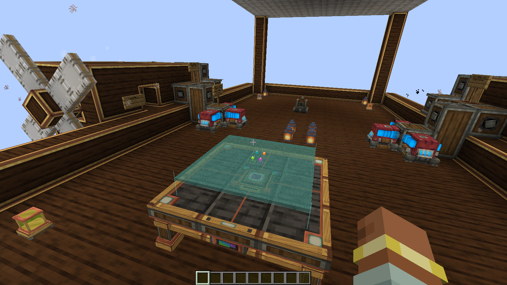

# Movement validation — 0.4.0-dev.2

Tested on 2026-10-25 with Minecraft 1.21.1, NeoForge 21.1.259, Create 6.0.10
and Java 21.0.12.1+1. The full pack includes Aeronautics/Simulated 1.3.2,
Sable 2.0.6 and Sable Companion 1.6.0. Graphical runs used Windows 11, an RTX
4090 and a 1600×900 window. No dependency upgrades are part of this preview.

This work is on the local `development/motion-following` branch. It does not
publish a release or change public `main`. The existing releases and
[previous preview evidence](development-validation.md) remain preserved.

## What changed

Already-tracked reference blocks now resolve against the same interpolated pose
used to render their Create contraption or Sable ship. Marker, link and entity
identities are checked before using that source; unavailable sources use the
last authoritative packet position. No terrain scans, entity searches or new
packets are performed per frame. Unknown or out-of-bounds map positions stay
hidden, rather than freezing a pin at the edge.

Sensors and tables poll every five ticks (0.25 seconds at 20 TPS). The scanner
finishes useful pending work, adopts it and requests the latest location in the
same poll. It no longer loses another polling interval between moving regions.
Its shared column budget, two-millisecond deadline, queue bound and stationary
refresh interval are unchanged. A busy queue, unloaded chunks or a slow server
can still delay terrain; smoother markers do not make terrain instantaneous.

Marker membership is refreshed after adopting a survey and before synchronizing
it. The renderer keeps its completed terrain mesh until a replacement is ready,
respecting the existing ten-tick rebuild throttle. Pins use the displayed mesh's
own origin, known cells and surface height during that transition. An explicit
relink to unavailable terrain clears the old display.

Both network registrars now use protocol 4. Clients and server must use the same
Hololith version. Saved terrain and instrument identities retain their format;
older marker records without render-source metadata use the fallback position.

## Completed checks

| Check | Result | Evidence |
|---|---|---|
| Compile, unit tests and distribution checks | 47 tests passed, none failed or skipped | [Unit suites](test-results/0.4.0-dev.2/unit-tests.json) |
| Create-only fresh world / new JVM reload | 86 / 47 checks passed | [Fresh](test-results/0.4.0-dev.2/minimal-fresh.json), [reload](test-results/0.4.0-dev.2/minimal-resume.json) |
| Real Create bearing/cart assembly and reload | 74 / 15 checks passed | [Fresh](test-results/0.4.0-dev.2/contraptions-fresh.json), [reload](test-results/0.4.0-dev.2/contraptions-resume.json) |
| Full-pack fresh world / new JVM reload | 110 / 45 checks passed | [Fresh](test-results/0.4.0-dev.2/full-pack-fresh.json), [reload](test-results/0.4.0-dev.2/full-pack-resume.json) |
| Player JAR on Create-only / full-pack dedicated servers | 15 / 15 checks passed | [Minimal server](test-results/0.4.0-dev.2/dedicated-minimal.json), [full server](test-results/0.4.0-dev.2/dedicated.json) |
| Public airship baseline and Hololith-equipped flight | 58 checks passed | [Airship report](test-results/0.4.0-dev.2/public-airship.json) |

Counts are assertions across repeatable profiles, not counts of unique user
scenarios. The game checks exercise real rendering, packets, linking, controls,
cached surveys, removal, assembly/disassembly and saved-state reload. The rapid
movement regression changes target region every five ticks and checks both
current marker membership and a continuously available completed GPU mesh.
The moving-cart check samples partial-frame positions between server ticks.

Both dedicated records identify the same tested player JAR SHA-256:
`3b8dfb8c89807fc2a2a470e614690b2ec1452ad0819e8b60358b7d17b0b6f785`.
The probe and optional ship classes are not bundled in that player JAR.

New unit checks cover moving-scan fairness, cached-region priority, stale-cache
rollback, source identity/link rejection, malformed and legacy marker records,
bounded 64-pin payloads and Sable entity-transform composition. Review and unit
math support nested Create/Sable transforms; an actually scaled nested
contraption has not received gameplay acceptance.

## Public airship acceptance

Patrik's [airship v10](https://createmod.com/schematics/airship-v10) is the
user-supplied public craft. [Provenance and reproduction](public-schematics.md)
record its controls, exact hashes and required assembly/fuel preparation.
The original file is preserved; the test copy omits only its bat and creeper.
Both propeller glue entities and the creator's blocks/machine data are retained.

Initial preparation found two practical import requirements: Create filters
portable-engine runtime fuel from schematics, and the download contains no hull
Honey Glue. The fixture uses normal Creative Blaze Cake interactions, a recorded
Honey Glue selection and a Physics Assembler in both trials. This is the creator
layout with documented setup, not an assertion that the raw download flies
without preparation. A failed baseline prevents the instrumented flight trial.
The separate "forwards" lever engages the drivetrain; W/S only changes its
throttle. The bounded pilot uses that lever and the original keyboard, with
measured lift/velocity feedback. Passing requires forward flight, steering,
throttle reduction and measured deceleration, not simply a rising balloon.

The completed trial passed all 58 checks. The baseline travelled 18.45 blocks
horizontally and rose 57.90 blocks; the instrumented version travelled 18.46 and
rose 57.64. Their measured heading changes were about 10.7° and 10.6°. Both
generated thrust from two propellers and slowed after reducing throttle and
selecting neutral. Mean horizontal speed fell from 0.0430 to 0.0052 blocks/tick
for the baseline, and 0.0422 to 0.0059 for the instrumented craft. These are
bounded test flights, not landing or long-range navigation acceptance.

During instrumented flight the survey adopted seven region centers. All 102
sampled four-marker server frames stayed within the measured update-latency
envelope; the largest instantaneous packet-position lag was 0.472 world blocks.
The client resolver matched an independently composed Sable render pose in all
10,844 marker samples, with zero recorded positional error. In 8,644 samples it
advanced beyond the packet's older position. This verifies agreement with the
rendered ship pose, not instantaneous terrain acquisition or real-world surveying
precision. The actual table built its GPU mesh and displayed all four pins.

Actual Minecraft capture from the disposable trial, using Patrik's credited
craft. [Imported craft view](../images/airship-v10-imported.png). The terrain is
the flat test world's real surface. The observer camera follows the ship; no
ship position, velocity or force was injected. Passenger riding and remote
multiplayer were not tested. The retained raw log also contains transient Sable
movement-packet and moved-accumulator warnings during assembly; the subsequent
client and server acceptance checks passed. This is not a warning-free pack claim.

## Limits

Graphical tests use an offline development identity and integrated server.
Dedicated checks establish server loading and actor lifecycle, not authenticated
remote multiplayer acceptance. Many viewers, low-end GPUs, arbitrary shaders,
natural chunk-unload travel, trains, gantries and other third-party controllers
still need separate acceptance. Controlled Sable translation/yaw checks are
distinct from powered public-airship flight. No lift detection, terrain
clearance calculations or landing-safety warnings were added.
